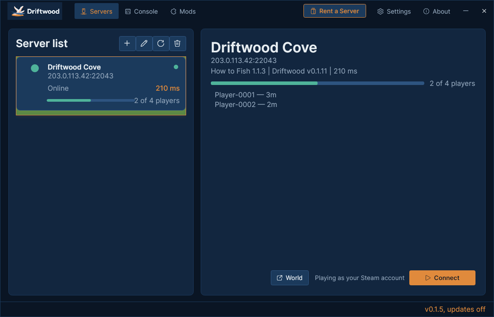
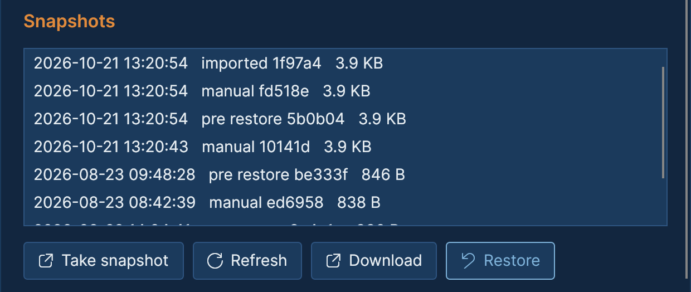
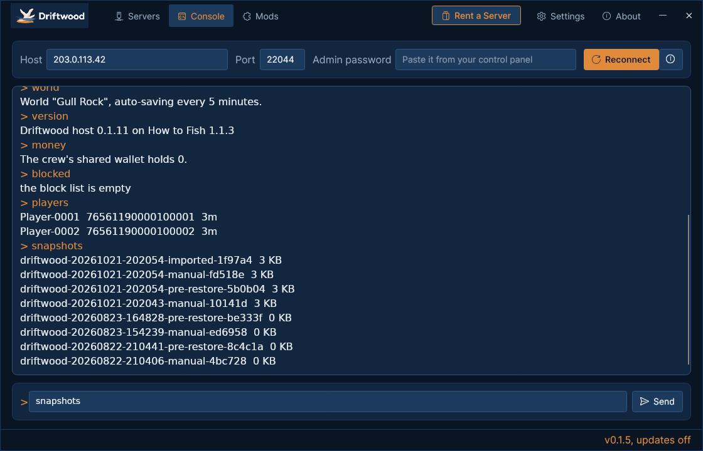

  <picture>
    <source media="(prefers-color-scheme: dark)" srcset="docs/img/driftwood-logo-dark.png">
    
  </picture>

  
  
  
  
  

# Driftwood

**How to Fish** has no dedicated server. Its co-op runs in a Steam lobby on one player's PC, so the island is only there while that player is playing. Driftwood adds a How to Fish dedicated server: [DriftwoodServer](https://github.com/HumanGenome/DriftwoodServer) runs the game headless on a Windows machine with a public IP and port, and the Driftwood app connects players to it by address.

Every player installs the Driftwood app, or its join mod from Thunderstore, to join a Driftwood server. Stock How to Fish cannot connect to a Driftwood server directly.

## Features

### 🧭 Join by IP
Add a server by its IP and port. The app shows whether it is up and who is on it, and **Connect** starts How to Fish and takes you in. The server loads the character saved under your Steam account, whatever order your crew joins in. After your first Connect, the same address also works in How to Fish's own **Join Game** box.

  

### 💾 World backups
The server writes the world to disk before every snapshot, so a backup is always a whole world. From the app's World window, owners take a snapshot, download one, restore an earlier world, upload a single-player save from their own PC, or bring the latest snapshot over from another of their servers.

  

### 🖥️ Server console
Owners paste the server's admin password once and run the server from the Console tab: status, players, saves and snapshots, kick and block, a `[Server]` line in everyone's chat, the crew's shared wallet, moving the crew to another island, and sending a stuck player back to shore.

  

### Also built in
- **Chat commands:** players type `!help`, `!stuck` (back to the island spawn), `!playtime` and `!top` into How to Fish's own chat.
- **Catch leaderboard:** every sale at the sell box counts for the player who caught the fish, and the board keeps catches, earnings, bosses and playtime. `!top` shows it in game; the console's `top` shows the full table.
- **Discord alerts:** point the server at a Discord webhook and it posts joins and leaves, boss kills, island moves and blocked join attempts.

## Install

### Rent a server
[How to Fish hosting from SurvivalServers.com](https://www.survivalservers.com/services/game_servers/how_to_fish/?utm_source=github&utm_medium=readme_install&utm_campaign=driftwood) comes with Driftwood installed, the ports open, and an address ready to hand to your players.

### Players
1. Download `DriftwoodSetup-latest.exe` from the [latest release](https://github.com/HumanGenome/Driftwood/releases/latest).
2. Run it. If Windows shows "Windows protected your PC", choose **More info**, then **Run anyway**.
3. Open Driftwood and add the server's IP and port.
4. Click **Connect**. The app readies How to Fish and takes you in.

### Players with a mod manager
Install [DriftwoodConnect](https://thunderstore.io/c/how-to-fish/p/HumanGenome/DriftwoodConnect/) with r2modman or Gale. Start How to Fish, open **Join Game**, paste the server's `address:port` into the lobby ID box and press **Join**. The mod tells the server which Steam account is joining, so you get your own character. The Console tab and World backups are in the app only.

### Self-hosted servers
The walkthrough is [DriftwoodServer's README](https://github.com/HumanGenome/DriftwoodServer#readme). You need a Windows machine, a copy of How to Fish's game files on it (from your own Steam copy; the server package ships no part of the game), and two open ports: the game port and the status port directly above it.

The server package is under a megabyte on top of the game's files. If a game update moves something the server depends on, the server refuses to host and names what moved.

### Admin password
The app's Console tab and World window ask for the server's admin password. It is not the password players join with, and players never need it. The app keeps it on your PC only.

- **Rented server:** your host shows it with your server's details.
- **Self-hosted:** it is the `authToken` you set in the server's config ([step 5 of DriftwoodServer's README](https://github.com/HumanGenome/DriftwoodServer#5-fill-in-the-config-and-pin-the-build)).

## Releases

This repo publishes the player app:

- `DriftwoodSetup-<version>.exe`, the installer for players
- `DriftwoodSetup-latest.exe`, the same installer at a download link that always points at the newest version
- `Driftwood-Portable-v<version>.zip`, the app without an installer
- `Driftwood-Launcher-Windows-x64-v<version>.zip`, the package the app downloads when it updates itself
- `checksums.txt`, the SHA-256 of each file

The server package for hosts lives on the [DriftwoodServer release page](https://github.com/HumanGenome/DriftwoodServer/releases/latest). What changed in the app is in [this repo's release notes](https://github.com/HumanGenome/Driftwood/releases); what changed on the server is in [DriftwoodServer's release notes](https://github.com/HumanGenome/DriftwoodServer/releases).

## Source

The server's source is public at [HumanGenome/DriftwoodServer](https://github.com/HumanGenome/DriftwoodServer). The app ships as release binaries from this repo.

Players only need this repo's releases; hosts run the server from DriftwoodServer's.

## FAQ

### How many players can join?
Up to four, the number Dazed Games gives on How to Fish's [Steam page](https://store.steampowered.com/app/4001890/). The game's own lobby code makes room for more, but we have not seen more than four people play together. The host sets the server's slot count, and a full server turns the next player away cleanly instead of half-admitting them.

### Does everyone need the app?
Everyone needs Driftwood's join mod, DriftwoodConnect. The app installs it on your first Connect, or a mod manager installs it from [Thunderstore](https://thunderstore.io/c/how-to-fish/p/HumanGenome/DriftwoodConnect/). Server owners use the app for the Console tab and World backups.

### Does single-player still work?
Yes. The join mod only steps in when you join a Driftwood server by address. Single-player and Steam lobbies play exactly as before.

### Does it change my game?
On your first Connect, the app copies a small mod loader (BepInEx) and the Driftwood join mod into your How to Fish folder. Your copy of How to Fish is still bought, launched and updated through Steam.

### Where is my character saved?
On the server, with the world, under your Steam account.

### Can I move a world to another server?
Yes. In the app's World window, download a snapshot from the old server and upload it on the new one, or pick the old server under **Migrate from another server**. A single-player save from your own PC uploads the same way. The new world takes over when the server next starts, and the server keeps a backup of the world it replaces.

### Why does Windows warn about the installer?
The installer is not code-signed, so Windows SmartScreen may show "Windows protected your PC". Choose **More info**, then **Run anyway**. You can check the file against the release's `checksums.txt`.

### Does the app update itself?
Yes. It checks for a new version when it starts and while it runs, and finishes the update once How to Fish is closed. Every update is signed, and the app refuses one that is not. Settings can turn the check off.

### Is Linux supported?
No. The app and the server are Windows only.

### Is this official?
No. Driftwood is an independent project. Dazed Games does not ship dedicated servers for How to Fish.

### Something broke
[Open an issue](https://github.com/HumanGenome/Driftwood/issues). If you rent a server, your host handles billing and control panel questions.

## Contributing

Bug reports and feature requests are welcome; see [CONTRIBUTING.md](CONTRIBUTING.md). Security issues go through [private reporting](.github/SECURITY.md), never a public issue.

## Community note

Driftwood is a community project and is not affiliated with, endorsed by, or supported by Dazed Games. How to Fish is their game: [buy it on Steam](https://store.steampowered.com/app/4001890/).

## License

This repo's README and docs are MIT, see [LICENSE](LICENSE). DriftwoodServer's source is MIT in its own repo. The app is free to download; its source is not public.

## Credits

- [BepInEx](https://github.com/BepInEx/BepInEx), the Unity modding framework the server side runs on
- [Avalonia](https://avaloniaui.net/), the .NET UI framework used by the Driftwood app
